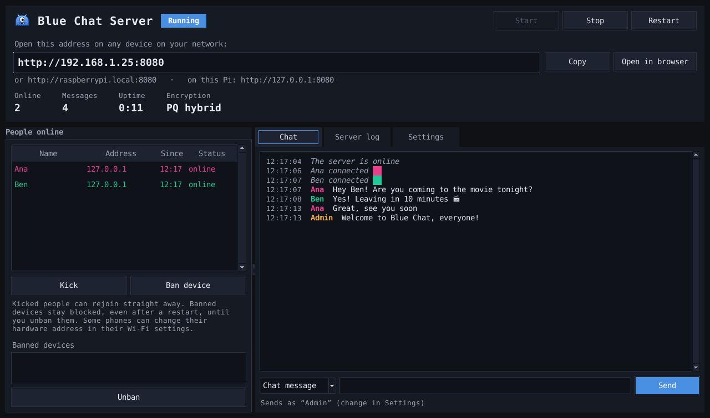
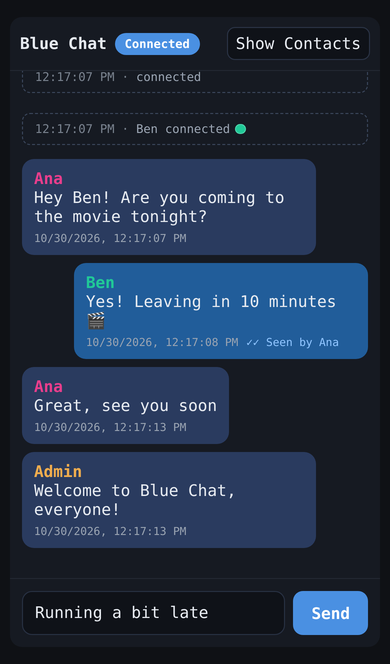
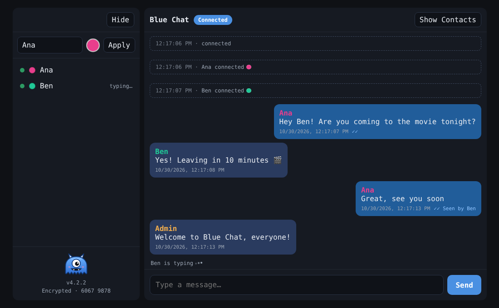
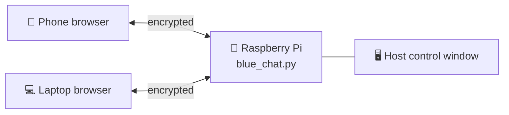
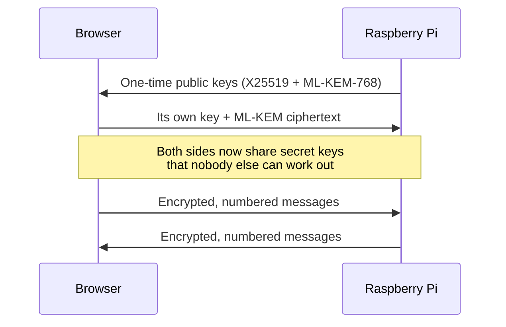

<p align="center">
  
</p>

<h1 align="center">Blue Chat</h1>

<p align="center">
  A private, encrypted chat room for everyone on your Wi-Fi, run from a Raspberry Pi.<br>
  No accounts, no apps to install, no internet needed.
</p>

<p align="center">
  
  
  
</p>

---

## Contents

- [What is Blue Chat?](#what-is-blue-chat)
- [Screenshots](#screenshots)
- [Features](#features)
- [What you need](#what-you-need)
- [Quick start](#quick-start)
- [Using Blue Chat](#using-blue-chat)
- [Running without a screen](#running-without-a-screen)
- [How it works](#how-it-works)
- [Security](#security)
- [Troubleshooting](#troubleshooting)
- [Files](#files)
- [Licence and credits](#licence-and-credits)

---

## What is Blue Chat?

Blue Chat turns a Raspberry Pi into a chat server for your local network. Start it on the Pi, and anyone on the same Wi-Fi can open the chat in their phone or computer's web browser and start talking. There's nothing to install and nobody needs an account.

The person running the Pi (the **host**) gets a control window to see who's online, read the chat, send announcements, and remove people if needed.

**Good for:**

- 🏠 Homes and share houses
- 🏫 Classrooms, workshops and clubs
- 🎪 Events, LAN parties and meetups
- 🏢 Small offices
- 📡 Places without internet. Blue Chat only needs a local network.

## Screenshots

| Host control window (on the Pi) | Chat on a phone |
| --- | --- |
|  |  |

| Chat in a desktop browser |
| --- |
|  |

## Features

**Chat**

- Works in any up-to-date web browser on phones, tablets and computers
- Choose your own name and colour
- Read receipts: ✓ sent, ✓✓ seen, and "Seen by Ana and Ben" on your latest message
- Typing indicators with animated dots ("Ben is typing")
- Shows who's online, who's typing and who has stepped away
- Status messages for everything that happens: joins, leaves, name and colour changes, timeouts, and people coming back
- Notices when a phone goes into the background and when it returns ("Ivy is back after 2m 5s")
- Reconnects automatically after Wi-Fi drops or a server restart, with no duplicate messages
- New arrivals see the last 75 messages
- Message box grows up to 5 lines as you type
- Designed for phones: stays above the on-screen keyboard, no accidental zooming, works in portrait

**Privacy and security**

- Every connection is encrypted with post-quantum-resistant cryptography (X25519 + ML-KEM-768, then ChaCha20-Poly1305 for every message)
- No certificates, no browser warnings, no sign-ups
- Messages can't be read, altered, replayed or reordered by others on the network
- Message lengths are hidden with padding
- Security codes let you check that nobody is interfering with your connection
- Chat history is kept in memory only and is never saved to disk
- Protection against flooding, spam and fake connections

**Host control window**

- Shows the address to share, with Copy and Open in browser buttons
- People online with their address, join time and status (online, typing or away)
- Kick people, or ban a device by its hardware (MAC) address until you unban it, even across restarts
- Send messages as the host, or centred announcements
- Live server log, with timestamps to the second, of everything that happens
- Export chat history as text or JSON, or clear it
- Settings: port, messages kept, host name and colour (with a preset colour picker), and whether to start the server and open the chat in a browser when the app opens
- Opens maximised, with its own icon in the taskbar and the applications menu
- Can also run without a screen (headless mode)

## What you need

| | Requirement |
| --- | --- |
| **Computer** | Any Raspberry Pi that runs Raspberry Pi OS |
| **Operating system** | Raspberry Pi OS Bullseye or newer. Trixie is recommended. |
| **Python** | 3.9 or newer, already included with Raspberry Pi OS |
| **Network** | All devices on the same Wi-Fi or wired network |
| **Guests** | Any up-to-date web browser (Safari, Chrome, Edge, Firefox) |

> [!NOTE]
> The **host control window** needs **Raspberry Pi OS with desktop**. On **Raspberry Pi OS Lite** (no desktop), Blue Chat runs in [headless mode](#running-without-a-screen) instead, and everything else works the same.

**Optional extras.** Blue Chat works without these:

```bash
sudo apt install python3-cryptography zenity
```

- `python3-cryptography` makes encryption faster
- `zenity` provides the preset colour picker. Without it, a built-in colour grid is used.

Blue Chat is written for Raspberry Pi OS but uses only standard Python, so it should also run on other Linux computers.

## Quick start

**1. Download Blue Chat onto your Pi.** Open a terminal and run:

```bash
git clone https://github.com/Digim0rt4l/blue-chat.git
cd blue-chat
```

Or click **Code → Download ZIP** on this page, then unzip it.

**2. Start it:**

```bash
python3 blue_chat.py
```

**3. Share the address.** The control window shows an address like `http://192.168.1.25:8080`. Anyone on your Wi-Fi can open it in their browser to join.

That's it! 🎉

> [!TIP]
> By default Blue Chat picks a random free port each time it starts. To keep the same address every time, so people can bookmark it, open **Settings**, untick **Random**, choose a port such as `8080`, and click **Save & restart**.

> [!IMPORTANT]
> Keep `blue_chat.py` and `index.html` in the same folder. They need each other.

## Using Blue Chat

### For guests

1. Open the address the host shares, for example `http://192.168.1.25:8080`
2. If the sidebar is hidden, tap **Contacts** (**Show Contacts** on wider screens). Type your name, pick a colour and tap **Apply**.
3. Start chatting

### For the host

| To do this | Do this |
| --- | --- |
| Share the chat | Click **Copy** next to the address and send it to people |
| Send a message | Type in the box at the bottom of the **Chat** tab and press **Send** |
| Send an announcement | Change **Chat message** to **Announcement** before sending |
| Remove someone | Select them under **People online** and click **Kick**. They can rejoin straight away. |
| Block a device | Select them and click **Ban device**. The ban lasts, even after a restart, until you select it under **Banned devices** and click **Unban**. |
| Start over | **Settings → Clear chat history** |
| See everything that happened | Open the **Server log** tab |
| Save the conversation | **Settings → Export history...** |
| Change your name or colour | **Settings → Your host name**, then **Save** |

Blue Chat also adds itself to the applications menu, under **Internet**, so you can start it from there next time.

## Running without a screen

On Raspberry Pi OS Lite, or over SSH, run Blue Chat in headless mode:

```bash
python3 blue_chat.py --headless --web-port 8080
```

It prints the chat address and a live log, with timestamps, of everything that happens. Press `Ctrl+C` to stop.

Bans made in the control window still apply in headless mode, and the log says how many are active when Blue Chat starts. To lift every ban without the control window, stop Blue Chat, delete `blue_chat_bans.json`, and start it again.

| Option | What it does |
| --- | --- |
| `--headless` | Runs without the control window |
| `--web-port 8080` | Uses a fixed port (from 1024 to 65535) instead of a random one |

**Start automatically when the Pi turns on:**

1. Run `crontab -e` and choose an editor if asked
2. Add this line at the bottom, changing the folder to wherever you put Blue Chat:

   ```text
   @reboot cd /home/pi/blue-chat && python3 blue_chat.py --headless --web-port 8080
   ```

3. Save, close, and restart the Pi

## How it works

Blue Chat is two files: a Python program that runs on the Pi, and a web page that it sends to each browser. Everything happens on your local network. Nothing goes to the internet.



1. **The page loads.** A guest opens the address. The Pi sends them `index.html`, which contains the chat and its encryption code.
2. **The keys are made.** The browser and the Pi make one-time keys for this connection only, using two methods at once. X25519 is proven classic cryptography. ML-KEM-768 is the new US government standard (FIPS 203) designed to resist quantum computers. An attacker would have to break both.
3. **Every message is sealed.** Each message is padded, numbered and encrypted with ChaCha20-Poly1305. Anything altered, replayed, reordered or unencrypted is refused.
4. **The Pi passes it on.** The Pi decrypts the message, checks it, and re-encrypts it separately for each person in the chat.



**What's stored:**

- **Chat history:** kept in the Pi's memory only, the last 150 messages by default. It's gone when the server stops.
- **Settings:** saved to `blue_chat_settings.json` next to the program. This holds your port, host name and colour, and other options. It never contains messages.
- **Bans:** saved to `blue_chat_bans.json` next to the program, so they last until you lift them. Each holds a name, the device's hardware (MAC) or IP address, the IP address it was using, and when it was banned.
- **Guests' browsers:** each one remembers only its own name, colour and a random ID.

## Security

**What Blue Chat protects against:**

- Anyone on your network trying to read or record the chat
- Recordings kept and decrypted years later with a quantum computer
- Messages being tampered with, replayed or reordered
- Banned devices getting back in by changing their IP address
- Other websites trying to connect to your chat
- Unknown scripts running in the chat page. The page only runs its own code.
- People flooding or spamming the chat

**The one limit to know about.** Blue Chat avoids certificates so that nobody sees browser warnings. The trade-off is that someone who can **actively tamper** with your network traffic (not just watch it) could swap in a fake copy of the page. This takes real effort on your network. To check for it:

1. Each guest sees a security code at the bottom of their sidebar, like `Encrypted · 5236 0598`
2. The host sees the same code in the **Server log** when they join (`Ana's security code is 5236 0598`)
3. If the codes match, nobody is in the middle. If they don't, someone may be interfering with your network.

**About bans.** The Pi bans a device by its hardware (MAC) address, which it reads from your network. If it can't see that address, it bans the IP address instead and says so in the **Server log**. This happens for the Pi itself, and for devices that reach the Pi through another router. Some phones can change their hardware address in their Wi-Fi settings, so a determined person could get around a ban that way.

> [!WARNING]
> Blue Chat is designed for networks you trust, like your home or classroom. Don't expose it to the internet through port forwarding.

## Troubleshooting

<details>
<summary><b>The control window doesn't open</b></summary>

If Blue Chat prints `Tkinter is not installed`, it carries on in headless mode. To get the control window, install Tkinter and start Blue Chat again:

```bash
sudo apt install python3-tk
```

If it prints `No display found`, it was started without a desktop, for example over SSH. Start it from the Pi's desktop instead, or keep using headless mode.

</details>

<details>
<summary><b>Guests can't open the address</b></summary>

- Make sure their device is on the **same Wi-Fi** as the Pi, not mobile data or a guest network
- Try the other address shown under the main one, for example `http://raspberrypi.local:8080`
- Some public or guest Wi-Fi networks block devices from talking to each other

</details>

<details>
<summary><b>The page says "Disconnected"</b></summary>

The page can't reach the Pi. Check that Blue Chat is still running. The page reconnects by itself as soon as the Pi is reachable again.

</details>

<details>
<summary><b>"Couldn't start the server"</b></summary>

If the message says `Could not open the web port`, another program is using that port. Choose a different port in **Settings**, or tick **Random**, then click **Save & restart**.

</details>

<details>
<summary><b>The taskbar shows the wrong icon</b></summary>

Close Blue Chat and start it again. The first run sets up the icon. If it still shows the wrong one, log out and back in once.

</details>

## Files

| File | What it is |
| --- | --- |
| `blue_chat.py` | The server and the host control window |
| `index.html` | The chat page that guests see, including its encryption code |
| `blue_monster.svg` | The Blue Chat logo |
| `screenshot-*.png` | Pictures for this README |
| `LICENSE` | The MIT Licence |
| `blue_chat_settings.json` | Your settings. Created by Blue Chat when you save them, not part of the download. |
| `blue_chat_bans.json` | Your bans. Created by Blue Chat when you ban someone, not part of the download. |

## Licence and credits

Blue Chat is released under the [MIT Licence](LICENSE).

The encryption in the web page uses these open-source libraries by [Paul Miller](https://paulmillr.com), also under the MIT Licence. Their licence notices are kept inside `index.html`.

- [noble-post-quantum](https://github.com/paulmillr/noble-post-quantum) for ML-KEM-768
- [noble-curves](https://github.com/paulmillr/noble-curves) for X25519
- [noble-ciphers](https://github.com/paulmillr/noble-ciphers) for ChaCha20-Poly1305
- [noble-hashes](https://github.com/paulmillr/noble-hashes) for SHA-256 and HKDF
